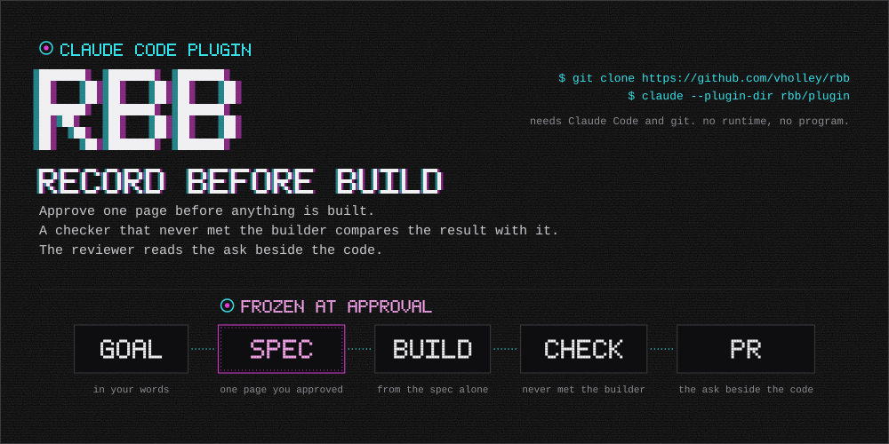
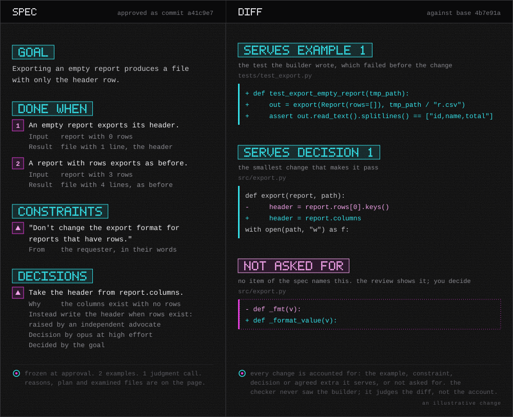

<p align="center">
  <a href="#start"></a>
</p>

<p align="center">
  <a href="#status"></a>&nbsp;&nbsp;
  <a href="#install"></a>&nbsp;&nbsp;
  <a href="LICENSE"></a>
</p>

<p align="center">
  <a href="#install">Install</a>&nbsp;&nbsp;·&nbsp;&nbsp;<a href="#start">Start</a>&nbsp;&nbsp;·&nbsp;&nbsp;<a href="docs/using.md">Using it</a>&nbsp;&nbsp;·&nbsp;&nbsp;<a href="docs/design.md">Why</a>
</p>

# RBB: Record Before Build

**Agree what will change before the agent builds it. Then check the code against that record, not against the agent's report.**

RBB is a Claude Code plugin. Before anything is built, you approve one page that says what will change, why, and how. The builder sees that page and nothing else. A checker that never met the builder compares the result with the page and lists every difference. The reviewer gets the page beside the code.

It needs Claude Code and git, and nothing else.

## Install

```bash
git clone https://github.com/vholley/rbb
```

```bash
claude --plugin-dir rbb/plugin
```

The first `/rbb` in a repository [sets it up](docs/using.md#setting-up): where records live, committed under `.rbb/<change>/` and removed after the merge, or only on your machine; where its permission rules go, so that only real decisions ask you; the commit style and the test command, read from the repository and confirmed by you. The GitHub CLI, signed in, is needed only to post pull requests from inside RBB.

## Start

```
/rbb Exporting an empty report crashes with a KeyError. It should produce a file with just the header row.
```

RBB shapes the goal, explores the code, drafts the page and asks you to approve it. Then it builds, checks and writes the pull request body without asking anything more. You answer a question or two about your intention, each with the real answers and the reason for the recommended one, and you approve once. `/rbb:pr <change> post` opens the pull request when you want it opened; `/rbb` alone resumes a change in progress.

<p align="center">
  <a href="docs/using.md#what-the-review-shows"></a>
</p>

## What you get

- You approve one page, once. It holds the goal, numbered examples of when it is done, your constraints in your words, what the scout saw when it reproduced the failure, every decision with its reasons and the alternatives an independent advocate raised, and the plan down to the lines it touches.
- The build is held to that page. The builder runs each example before and after, makes the smallest change that passes them, and logs every decision and deviation. Its log may say only what `git diff` shows.
- A checker you did not write labels every change with the item it serves, or marks it not asked for. The builder's claims are checked against the diff, and a claim the diff cannot show is handed to you to confirm.
- The pull request body is your template, filled: the goal, each change and where it is, each difference in one line, what no example exercises, and a link to the review. A reviewer who was not in the session reads the change against the ask.

## Why

Agents change code nobody asked them to change, in [a third to two thirds of runs](docs/design.md#f1-1) on tasks that needed no change at all, and their reports leave most of it out. When the task cannot be done honestly, [about half](docs/design.md#f2-1) cheat, usually by editing the tests. A person approving a plan or reading a pull request usually has only the agent's account to go on, written after the work by the party whose work it describes.

RBB writes down what was asked before anything is built, where the agent cannot change it, and compares the result with that record instead of with the account. The ideas, the evidence with its sources, and the alternatives set aside are in [docs/design.md](docs/design.md).

## What RBB does not claim

- That the model's decisions are right. They are shown with their reasons and the other side, and you can reverse them at approval and at review.
- That no ambiguity remains. Agents find [under half of the gaps](docs/design.md#f5-13) expert maintainers raise. RBB settles or asks about every gap the scout finds and writes its assumptions on the page, so you can catch the rest.
- That the checker sees everything. Its reach is unmeasured beyond the development runs, and a claim the change alone cannot show is handed to you.
- That the cost is nothing. A scout with its advocate takes about five minutes, a build, a check and a pull request body a few minutes each, and you read one page per change. Whether that pays for itself has not been measured.

The full list is in [docs/design.md](docs/design.md#what-rbb-does-not-claim).

## Status

Preview. Every step has run live on one task, on Windows, by RBB's author, including posting a pull request and clearing records in both modes. Linux and macOS have not been run. Nothing here is installed by anyone else yet.

## Documentation

[Using it](docs/using.md): a first session, every command, the pages, the records, the permission rules, what to do when something goes wrong. [Why](docs/design.md): the ideas and the evidence.

## License

[Apache License 2.0](LICENSE).
